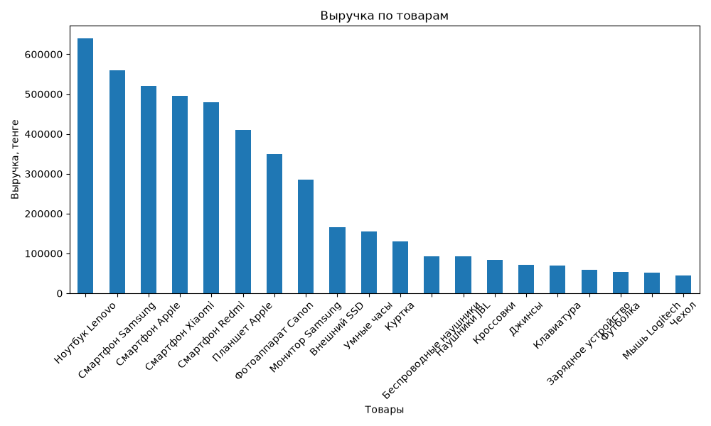
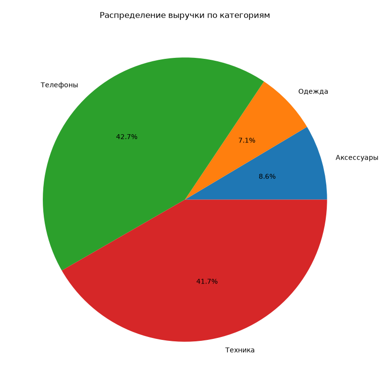
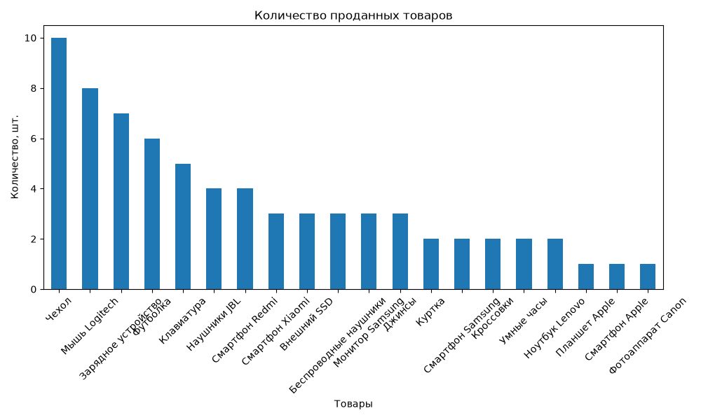

# Анализ продаж и визуализация данных

## Описание проекта

Проект посвящён анализу продаж магазина с помощью Python,
SQLite, Pandas и Matplotlib.

## Используемые технологии

- Python
- SQLite
- Pandas
- Matplotlib

## Выполненные задания

1. Получение данных из базы SQLite.
2. Расчёт общей выручки магазина.
3. Подсчёт количества проданных товаров.
4. Определение ТОП-3 товаров по выручке.
5. Построение диаграммы выручки по товарам.
6. Построение круговой диаграммы по категориям.
7. Построение диаграммы количества продаж.
8. Сохранение графиков в формате PNG.

## Результаты

Программа автоматически рассчитывает показатели
на основе данных из базы данных shop.db.

При изменении данных в базе показатели и диаграммы
пересчитываются после повторного запуска программы.

## Графики

### Выручка по товарам


### Выручка по категориям


### Количество проданных товаров


## Запуск программы

Установить библиотеки:

```bash
python -m pip install pandas matplotlib
```

Запустить анализ:

```bash
python analysis.py
```
